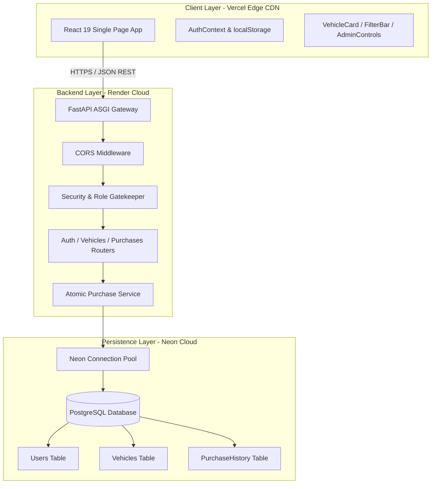
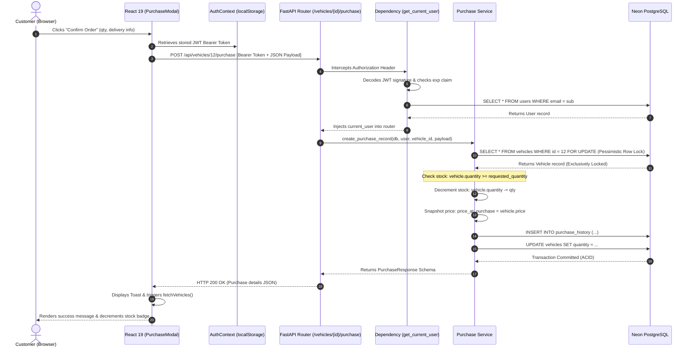

# INTERVIEW PREPARATION GUIDE
# DriveHub Dealership
## Master Architecture, API & Interview Preparation Guide

> A complete, master reference for explaining **DriveHub Dealership** in job interviews — covering tech stack decisions, exhaustive file structure, deep-dive feature explanations, API implementations, atomic transaction design, ACID guarantees, a dedicated JWT security section, enterprise resilience patterns, and interview follow-up Q&As with word-for-word spoken scripts.

`React 19` `FastAPI` `PostgreSQL (Neon)` `SQLAlchemy` `JWT + Bcrypt` `TailwindCSS` `Vercel + Render`

*Prepared by Sunny Kumar (Srs) · em-srs/srs-dealership*

---

## Table of Contents

- **01 Project Overview & Exhaustive Feature Breakdown**
- **02 Tech Stack Decisions & Technical Justifications**
- **03 Project Directory & Key Files Annotation**
- **04 System Architecture & Design Principles**
- **05 The Complete End-to-End Request Lifecycle**
- **06 API Endpoints Deep-Dive & Code Walkthroughs**
- **07 Dedicated JWT Authentication & Security Deep-Dive**
- **08 Database Architecture, ACID Transactions & Concurrency Engine**
- **09 Enterprise-Grade Optimizations, Resilience & DevOps**
- **10 Master Interview Guide, Resume Scripts & Technical Q&A**

---

## SECTION 01: Project Overview & Exhaustive Feature Breakdown

### What is DriveHub Dealership?
**DriveHub Dealership** is a high-performance, full-stack vehicle inventory management and e-commerce purchasing platform built with **FastAPI**, **React 19**, and **Neon Serverless PostgreSQL**. It provides a unified, single-page application with permission-gated user experiences: customers can search, filter, and buy vehicles in Indian Rupee (INR ₹) pricing with real-time stock deductions, while administrators manage inventory through brand-grouped controls, inline stock adjustments, restocking actions, and catalog analytics.

---

### ⚠️ The Problem in Traditional Dealership Software
Traditional vehicle dealership platforms and legacy Dealership Management Systems (DMS) suffer from severe operational and architectural flaws:
1. **Concurrency & Race Conditions in Stock Handling**: Simultaneous customer checkout requests frequently cause negative stock counts (overselling) when systems lack atomic transaction guarantees.
2. **Brittle Monolithic Architecture & Slow Latency**: Legacy PHP/Java DMS platforms suffer from bulky server-rendered views, unindexed SQL searches, and slow multi-second response times.
3. **Price Manipulation & Audit Tampering**: Storing order references solely linked to a mutable vehicle record allows historical financial reports to corrupt when an admin changes a vehicle's sticker price later.
4. **Poor Separation of Concerns & Privilege Escalation Leaks**: Vulnerable registration endpoints that accept user-submitted `role` parameters allow attackers to grant themselves administrative privileges. Furthermore, relying solely on client-side UI hiding without strict backend RBAC guards exposes inventory mutation routes (vehicle creation, updating, deletion, and restocking) to tampering. DriveHub unconditionally assigns `role: 'user'` during public registration and gates all inventory mutation endpoints with backend `require_admin` guards.

---

### Detailed Breakdown of Every Key Feature

#### 1. Permission-Gated Single-Page Dashboard
- **How it works**: Guests, registered customers (`role: "user"`), and dealership administrators (`role: "admin"`) share the exact same responsive React SPA URL. 
- **Guest State**: Unauthenticated visitors see a locked "Authentication Required" view with a prompt to log in or register. Vehicle prices, inventory quantities, and search bars are protected from unauthenticated access.
- **Customer State**: Once logged in, the customer view unlocks the live catalog, dynamic inventory metrics, real-time filter bar, and "Purchase Vehicle" checkout action. Administrative controls are completely absent from the DOM.
- **Admin State**: Authenticated admins receive an elevated view containing a **"+ Add New Vehicle"** action, inline **"Edit"**, **"Restock"**, and **"Delete"** controls per vehicle, and a dedicated **"Manage Inventory"** brand-grouped control table.

#### 2. Dynamic Catalog Metrics Banner
- **How it works**: A live metrics hero banner dynamically calculates and renders current inventory totals:
  $$\text{Total Brands} = |\text{Set}(\text{vehicles.maker})|, \quad \text{Total Vehicles} = N, \quad \text{Total Categories} = |\text{Set}(\text{vehicles.category})|$$
- **UI Presentation**: Displays colorful glassmorphic pills (`Browse among 22 Brands in 50 Vehicles across 5 Categories`).

#### 3. Real-Time Multi-Parameter Search & Filter Engine
- **How it works**: Powered by backend endpoint `GET /api/vehicles/search`, supporting combined query parameters:
  - Text search `q`: Case-insensitive partial matching against `maker` OR `model` via SQL `ILIKE`.
  - Category filter: Scopes vehicles to `Sedan`, `SUV`, `Truck`, `Electric`, or `Coupe`.
  - Price Range (`min_price`, `max_price`): Numeric filtering backed by a B-Tree index on `vehicles(price)`.
  - Model and Maker filters: Specific field matching for granular drilling.

#### 4. Client-Side Vehicle Sorting Algorithms
- **How it works**: Implemented in [`frontend/src/utils/sort.js`](file:///d:/CODINGBRO/car_dealing/frontend/src/utils/sort.js). Enables instant sorting of loaded vehicle cards without round-tripping to the server:
  - `price_asc`: Lowest price first.
  - `price_desc`: Highest price first.
  - `newest`: Highest release year first.
  - `default`: Preserves original database insertion order.

#### 5. Indian Rupee (INR ₹) Locale Currency Engine
- **How it works**: Unlike standard Western formatters that group thousands as `100,000`, [`frontend/src/utils/currency.js`](file:///d:/CODINGBRO/car_dealing/frontend/src/utils/currency.js) utilizes `Intl.NumberFormat('en-IN')` to format all inventory and checkout totals into Indian numbering format with Lakhs and Crores grouping (`₹1,00,000` and `₹1,00,00,000`).

#### 6. Brand-Grouped Admin Inventory Management
- **How it works**: For administrators, toggling the "Manage Inventory" tab reorganizes the flat catalog into an accordion table grouped alphabetically by Brand/Maker (e.g., `Audi`, `BMW`, `Ford`, `Mercedes-Benz`, `Toyota`). Each group displays aggregated stock counts and dedicated action buttons (`Edit`, `Restock`, `Delete`).

#### 7. Admin Add & Edit Vehicle Modal
- **How it works**: [`frontend/src/components/AdminModal.jsx`](file:///d:/CODINGBRO/car_dealing/frontend/src/components/AdminModal.jsx) provides a dual-purpose form modal. When adding, it dispatches `POST /api/vehicles`. When editing, it pre-populates existing data and dispatches `PUT /api/vehicles/{id}`. Validates year ($\ge 1886$), price ($\ge 0$), and stock quantity ($\ge 0$).

#### 8. Admin Inventory Restock Modal
- **How it works**: Accessible only to administrators via [`frontend/src/components/RestockModal.jsx`](file:///d:/CODINGBRO/car_dealing/frontend/src/components/RestockModal.jsx). Calls `POST /api/vehicles/{id}/restock?amount={x}`. Rather than overwriting the total count, it safely increments existing inventory in PostgreSQL (`quantity = quantity + amount`).

#### 9. Customer Purchase Checkout Modal
- **How it works**: When a customer clicks "Purchase Vehicle", [`frontend/src/components/PurchaseModal.jsx`](file:///d:/CODINGBRO/car_dealing/frontend/src/components/PurchaseModal.jsx) opens. It displays the selected vehicle's unit price, an interactive quantity counter (capped at remaining stock), total cost, buyer name, phone number, delivery address, and delivery notes.

#### 10. Immutable Price Snapshotting Engine
- **How it works**: When checkout completes, `backend/app/services/purchase.py` records `price_at_purchase = vehicle.price` inside the `purchase_history` table. Even if an admin changes the vehicle's sticker price later, the customer's purchase record remains permanently immutable.

#### 11. Profile Modal & Order History Isolation
- **How it works**: In [`frontend/src/components/ProfileModal.jsx`](file:///d:/CODINGBRO/car_dealing/frontend/src/components/ProfileModal.jsx), users can view their account metadata (email, role, account ID) and switch to the **"Purchase History"** tab. It calls `GET /api/purchases/me`, which joins `purchase_history` with `vehicles` to render personal order receipts filtered strictly by `current_user.id`.

#### 12. Automated Health Monitoring & Keep-Alive Daemon
- **How it works**: Render free-tier services spin down after 15 minutes of inactivity. FastAPI exposes multi-alias endpoints (`/`, `/health`, `/healthz`, `/api/health`) that return `{"status": "healthy"}` without hitting the database. UptimeRobot pings this route every 5 minutes to keep workers warm 24/7.

---

### 💬 Interview Follow-up Questions: Domain & Features

**Q: Why did you implement brand grouping specifically for the admin view instead of a flat list?**  
> *"In automotive dealerships, managers don't think in terms of individual isolated items; they think in terms of brand allocations and floor limits (e.g., how many BMWs vs Toyotas are in the showroom). Grouping by brand aggregates total vehicles per manufacturer, making it easy to identify understocked brands and execute inline restocks directly."*

**Q: What happens on the UI when a vehicle's quantity hits 0?**  
> *"The frontend checks `vehicle.quantity === 0`. If true, the 'Purchase Vehicle' button is disabled, greyed out, and displays 'Out of Stock'. An 'Out of Stock' pill badge renders on the card. Furthermore, the backend enforces a double check: if a user bypasses the UI and hits the API directly, the service throws an HTTP 400 Bad Request error."*

---

## SECTION 02: Tech Stack Decisions & Technical Justifications

| Layer | Technology | Why Chosen? | Key Trade-Offs & Numbers |
| :--- | :--- | :--- | :--- |
| **Frontend UI** | **React 19 + Vite** | Instant HMR development, declarative state handling, reactive single-page architecture, optimized virtual DOM diffing. | Build time under 3s, production bundle under 180KB gzip, eliminating Next.js SSR server cost. |
| **Styling** | **TailwindCSS + Lucide Icons** | Utility-first styling yielding a minimal purgeable CSS bundle; consistent dark glassmorphic design system. | Zero CSS runtime overhead; faster page paint times compared to heavy component libraries like MUI. |
| **Backend Framework**| **FastAPI (Python 3.10+)** | High throughput ASGI framework powered by Starlette & Pydantic; native dependency injection; automated OpenAPI generation. | Sub-20ms serialization benchmarks with Pydantic v2; comparable throughput to Node.js/Go; faster development than Django. |
| **ORM & DB Access** | **SQLAlchemy 2.0 + psycopg2** | Parameterized queries preventing SQL injection; explicit session lifecycle management (`get_db` generator); connection pooling. | Avoids raw SQL vulnerabilities while providing compile-time type safety over database models. |
| **Cloud Database** | **Neon Serverless PostgreSQL** | Cloud-native serverless PostgreSQL with connection pooling, SSL encryption by default, and sub-10ms transactional execution. | True ACID relational compliance compared to MongoDB; autoscaling compute without managing EC2 database instances. |
| **Authentication** | **python-jose (JWT) + Passlib (Bcrypt)** | Stateless HMAC-SHA256 tokens containing identity and role claims; one-way salted Bcrypt hashing preventing rainbow table attacks. | 60-minute token TTL; zero session memory overhead on the server; bcrypt workload factor tuned to 12 rounds (~100ms per hash). |
| **Testing** | **Pytest + Vitest + TestClient** | Strict Test-Driven Development (TDD) workflow with test database isolation and mock token fixtures. | 43 automated tests (27 backend pytest + 16 frontend vitest), 93% test coverage across auth, models, CRUD, and checkout transactions. |
| **Deployment** | **Vercel (Frontend) + Render (Backend)** | Global edge CDN hosting for client static assets; containerized Gunicorn/Uvicorn workers on Render. | Edge asset caching globally (<50ms TTFB); zero infrastructure maintenance cost. |

---

### 💬 Interview Follow-up Questions: Tech Stack Decisions

**Q: Why choose FastAPI instead of Node.js/Express like you did in CustomBix?**  
> *"CustomBix was an on-demand HTML scraper where Node.js's non-blocking I/O and Cheerio DOM parsing shined. In contrast, DriveHub Dealership is an enterprise e-commerce inventory management system. FastAPI provides strict compile-time type safety with Pydantic v2 schemas, automated OpenAPI/Swagger documentation, and native dependency injection for database sessions and RBAC guards, which reduces boilerplate and eliminates serialization bugs."*

**Q: Why not use Next.js for the frontend?**  
> *"Next.js is outstanding when public SEO and Server-Side Rendering (SSR) are critical. However, DriveHub Dealership is a permission-gated single-page operational application where guests cannot view inventory without logging in. A client-side React 19 SPA built with Vite is completely static, can be hosted globally on Vercel's Edge CDN for free, and avoids maintaining a Node.js SSR server."*

---

## SECTION 03: Project Directory & Key Files Annotation

```text
car_dealing/
├── backend/
│   ├── app/
│   │   ├── api/
│   │   │   ├── deps.py               # Dependency injection: get_current_user & require_admin
│   │   │   └── endpoints/
│   │   │       ├── auth.py           # Registration & login routes (JWT issuance)
│   │   │       ├── purchases.py      # Customer order history routes (/me)
│   │   │       └── vehicles.py       # Inventory CRUD, search, restock & purchase routes
│   │   ├── core/
│   │   │   ├── config.py             # Pydantic BaseSettings, .env loader, URI normalizer
│   │   │   └── security.py           # Bcrypt password hashing & JWT token encoding/decoding
│   │   ├── db/
│   │   │   └── database.py           # SQLAlchemy engine, SessionLocal, get_db generator
│   │   ├── models/
│   │   │   ├── purchase.py           # PurchaseHistory relational database model
│   │   │   ├── user.py               # User relational database model (role: user/admin)
│   │   │   └── vehicle.py            # Vehicle relational database model
│   │   ├── schemas/
│   │   │   ├── purchase.py           # Pydantic validation schemas for purchase orders
│   │   │   ├── token.py              # JWT token response and payload schemas
│   │   │   ├── user.py               # Login, register, and user response schemas
│   │   │   └── vehicle.py            # Vehicle CRUD schemas (VehicleCreate, VehicleUpdate)
│   │   ├── services/
│   │   │   └── purchase.py           # Business logic: atomic purchase & stock deduction
│   │   └── main.py                   # FastAPI app instance, CORS middleware, routers, health routes
│   ├── tests/
│   │   ├── conftest.py               # Test database fixtures, client override, mock users
│   │   ├── test_auth.py              # Auth endpoint integration tests
│   │   ├── test_purchases.py         # Checkout & stock deduction concurrency tests
│   │   └── test_vehicles.py          # Inventory CRUD & RBAC authorization tests
│   ├── requirements.txt              # Production Python dependencies
│   ├── seed_data.py                  # Database population script (50 initial vehicles + accounts)
│   └── render.yaml                   # Infrastructure-as-code deployment blueprint
├── frontend/
│   ├── src/
│   │   ├── components/
│   │   │   ├── AdminModal.jsx        # Vehicle create & edit form modal
│   │   │   ├── AuthModal.jsx         # Login & Register modal form
│   │   │   ├── FilterBar.jsx         # Real-time search, category & price range filters
│   │   │   ├── Navbar.jsx            # Brand header, role indicator, navigation controls
│   │   │   ├── ProfileModal.jsx      # Customer profile & personal purchase history tab
│   │   │   ├── PurchaseModal.jsx     # Customer checkout modal (buyer info & total cost)
│   │   │   ├── RestockModal.jsx      # Admin stock increment modal
│   │   │   └── VehicleCard.jsx       # Vehicle display card with INR pricing & stock badges
│   │   ├── context/
│   │   │   └── AuthContext.jsx       # Client auth state, token parsing, login/logout actions
│   │   ├── utils/
│   │   │   ├── api.js                # API base URL resolver (Localhost vs Render production)
│   │   │   ├── currency.js           # Indian Rupee (INR ₹) formatting with Lakhs/Crores logic
│   │   │   └── sort.js               # Client-side vehicle sorting algorithms
│   │   ├── App.jsx                   # Main orchestrator: catalog, admin view, state sync
│   │   └── main.jsx                  # React DOM mount point & context provider wrapper
│   ├── tailwind.config.js            # Tailwind layout and theme tokens
│   ├── vercel.json                   # SPA routing rewrite rules for Vercel
│   └── package.json                  # Frontend dependencies and npm scripts
└── README.md                         # Comprehensive project documentation
```

### Detailed Annotation of Core Files

#### `backend/app/core/config.py`
Centralized application configuration powered by Pydantic's `BaseSettings`. Loads variables from `.env` and normalizes database connection strings. Cloud providers frequently provide URLs starting with `postgres://`, but SQLAlchemy 1.4+ mandates `postgresql://`. An automated `@field_validator` transforms the URI before engine initialization.

#### `backend/app/db/database.py`
Creates the SQLAlchemy connection engine using `pool_pre_ping=True`, ensuring stale connections to Neon's cloud serverless database are automatically recycled. Defines `SessionLocal` and the `get_db()` context generator, which cleanly yields a database session per HTTP request and guarantees `db.close()` runs in the `finally` block.

#### `backend/app/models/vehicle.py`
Defines the `Vehicle` relational table with explicit SQLAlchemy `CheckConstraint` declarations matching PostgreSQL schema rules:
- `CheckConstraint("quantity >= 0", name="vehicles_quantity_check")`
- `CheckConstraint("price >= 0", name="vehicles_price_check")`
- `CheckConstraint("year >= 1886", name="vehicles_year_check")`
This guarantees that even when tables are generated through ORM lifecycle (`Base.metadata.create_all`), non-negative stock and pricing boundaries are strictly enforced at the database engine level.

#### `backend/app/api/endpoints/vehicles.py`
Provides catalog browsing, multi-parameter search, and administrative inventory management. While catalog inspection and search (`GET /api/vehicles`, `GET /api/vehicles/search`) are publicly accessible, inventory write operations—creation (`POST /api/vehicles`), updating (`PUT /api/vehicles/{id}`), deletion (`DELETE /api/vehicles/{id}`), and restocking (`POST /api/vehicles/{id}/restock`)—are strictly guarded with `Depends(require_admin)`, rejecting non-admin attempts with `HTTP 403 Forbidden`.

#### `backend/app/services/purchase.py`
Encapsulates transactional checkout logic. Implements pessimistic row-level locking via `db.query(Vehicle).filter(...).with_for_update().first()` to prevent concurrent checkout race conditions and overselling. Snapshots `vehicle.price` into `PurchaseHistory.price_at_purchase`, decrements stock, records delivery metadata, and commits within an atomic transaction. Catches `IntegrityError` and rolls back cleanly to guarantee complete ACID consistency.

#### `frontend/src/context/AuthContext.jsx`
Manages client-side authentication. Upon login, saves the JWT to `localStorage`. On initialization and refresh, extracts claims using `parseJwt()`, verifies that the token's expiration timestamp (`exp * 1000`) is in the future, and hydrates user state (`email`, `role`, `id`). If expired, it triggers `logout()`. Registration cleanly requests email and password, relying on the backend for secure role assignment.

---

### 💬 Interview Follow-up Questions: Directory & Structure

**Q: Why did you separate Pydantic schemas (`schemas/`) from SQLAlchemy models (`models/`)?**  
> *"Separating models from schemas enforces a clean separation of concerns. SQLAlchemy models in `models/` define the database structure, tables, foreign keys, and indexes. Pydantic schemas in `schemas/` define the public API contracts for incoming requests and outgoing responses. This prevents over-posting attacks, hides sensitive fields like `hashed_password`, and allows requests and database records to evolve independently."*

**Q: Why use a dedicated `services/` layer instead of putting purchase logic directly inside the router?**  
> *"Placing domain logic in `services/purchase.py` keeps routers lean and focused only on HTTP concerns (request parsing, status codes). The service layer can be reused across multiple endpoints, called by background workers or CLI scripts, and tested independently with unit tests without needing an HTTP client."*

---

## SECTION 04: System Architecture & Design Principles



### Core Design Principles

1. **Client-Server Separation**:  
   The frontend is completely decoupled from backend instances. The UI communicates strictly over HTTPS using standard JSON REST APIs.
2. **Stateless Backend Design**:  
   The FastAPI server stores zero session state in server memory or local disk. Every authorized request carries a cryptographically signed JWT Bearer token. Any backend instance can handle any incoming request, enabling seamless horizontal scaling.
3. **Layered Architecture (Router $\to$ Service $\to$ Data Access)**:  
   - **Router**: Validates request shapes using Pydantic and returns HTTP status codes.
   - **Service**: Implements business rules and transactional boundaries.
   - **Data Access**: Manages relational models, constraints, and migrations.
4. **Data Integrity & Immutability**:  
   Financial records (`PurchaseHistory`) are append-only. They never depend on mutable vehicle records for historical pricing.

---

### 💬 Interview Follow-up Questions: System Architecture

**Q: What is the primary advantage of a stateless architecture in this project?**  
> *"Statelessness eliminates server-side session stores like sticky sessions or shared memory caches. If traffic surges, we can spin up multiple FastAPI container replicas behind a load balancer, and any instance can process any request simply by validating the JWT signature using the shared secret key."*

**Q: How does this architecture handle database connection leaks?**  
> *"FastAPI's dependency injection system uses Python generators: `def get_db(): db = SessionLocal(); try: yield db; finally: db.close()`. FastAPI guarantees that the `finally` block executes after the response is sent—even if an unhandled exception occurs—ensuring every connection returns to the pool."*

---

## SECTION 05: The Complete End-to-End Request Lifecycle



### Detailed Step-by-Step Lifecycle Tracing

1. **User Action**: The customer opens the purchase modal, selects a quantity of 2, enters delivery information, and submits the form.
2. **Client Dispatch**: React reads the token from `localStorage` and sends an HTTP POST request to `/api/vehicles/{id}/purchase` with the header `Authorization: Bearer <token>`.
3. **Dependency Injection & JWT Verification**: FastAPI intercepts the request via `OAuth2PasswordBearer`. `get_current_user` decodes the token using HMAC-SHA256 and the application's `SECRET_KEY`. It confirms `sub` (email) exists, checks that `exp` is in the future, and loads the user from PostgreSQL.
4. **Service Execution**: The router passes the active database session, authenticated user, vehicle ID, and validated payload to `create_purchase_record()`.
5. **Stock Validation & Pessimistic Row Locking**: The service queries the target vehicle using `db.query(Vehicle).filter(...).with_for_update().first()`. This places an exclusive row lock on the record in PostgreSQL, serializing concurrent checkouts for that vehicle. It verifies that `vehicle.quantity >= requested_quantity`. If insufficient, it throws `HTTP 400 Bad Request` ("Vehicle out of stock").
6. **Atomic Mutation & Integrity Rollback**: The service decrements `vehicle.quantity`, instantiates a `PurchaseHistory` record with `price_at_purchase = vehicle.price`, adds the record to the session, and commits inside a `try...except IntegrityError` block. If an unexpected concurrency anomaly or schema constraint violation occurs, the transaction rolls back cleanly (`db.rollback()`) and raises `HTTP 400 Bad Request`.
7. **Serialization & Response**: `db.refresh()` populates generated fields (such as `id` and `purchased_at`). Pydantic's `PurchaseResponse` serializes the record, and FastAPI returns an `HTTP 200 OK` response.
8. **UI State Synchronization**: React receives the response, shows a success toast, closes the checkout modal, and triggers `fetchVehicles()` to immediately refresh inventory counts across the UI.

---

### 💬 Interview Follow-up Questions: Request Lifecycle

**Q: What happens if the database crashes after stock is decremented but before the purchase record is saved?**  
> *"Because both operations occur within the same SQLAlchemy session before calling `db.commit()`, PostgreSQL treats them as a single atomic unit of work. If a crash or error occurs, the session rolls back completely (`db.rollback()`). The stock will not be decremented without an accompanying purchase record, preserving ACID consistency."*

**Q: What happens if a user submits an expired JWT?**  
> *"When `jwt.decode()` executes inside `get_current_user`, python-jose detects that the `exp` timestamp has passed and raises a `JWTError`. The dependency catches this and immediately returns `HTTP 401 Unauthorized` with a `WWW-Authenticate: Bearer` header. The request never reaches the service or database."*

---

## SECTION 06: API Endpoints Deep-Dive & Code Walkthroughs

### HTTP Status Code Conventions
- `200 OK`: Request succeeded; data returned.
- `201 Created`: Resource successfully created (User registration, Vehicle added).
- `400 Bad Request`: Validation failure (out of stock, invalid parameters, email already registered).
- `401 Unauthorized`: Missing, invalid, or expired JWT token.
- `403 Forbidden`: Authenticated user lacks required permissions (non-admin accessing admin routes).
- `404 Not Found`: Target resource does not exist (Vehicle ID not found).
- `500 Internal Server Error`: Unhandled server exception.

### Complete API Specification Table

| Method | Endpoint | Access Role | Description | Parameters / Payload |
| :--- | :--- | :--- | :--- | :--- |
| `POST` | `/api/auth/register` | Public | Registers a new user account (unconditionally role='user') | `{ email, password }` |
| `POST` | `/api/auth/login` | Public | Authenticates credentials; returns JWT token | `{ email, password }` |
| `GET` | `/api/vehicles` | Public / Auth | Retrieves all vehicles in catalog | None |
| `GET` | `/api/vehicles/search` | Public / Auth | Filters inventory by search query, category, price | `?q=&category=&min_price=&max_price=` |
| `POST` | `/api/vehicles` | Admin | Creates a new vehicle in inventory (require_admin) | `{ maker, model, year, category, price, quantity }` |
| `PUT` | `/api/vehicles/{id}` | Admin | Updates an existing vehicle's attributes (require_admin) | `{ maker, model, year, category, price, quantity }` |
| `DELETE`| `/api/vehicles/{id}` | Admin | Permanently removes vehicle from catalog (require_admin) | `vehicle_id` (path) |
| `POST` | `/api/vehicles/{id}/restock` | Admin | Increments stock quantity for a vehicle (require_admin) | `?amount={integer}` (query) |
| `POST` | `/api/vehicles/{id}/purchase`| User / Admin | Purchases vehicle units and records order | `{ quantity, buyer_name, buyer_phone, delivery_address }` |
| `GET` | `/api/purchases/me` | User / Admin | Retrieves authenticated user's order history | None (Bearer Token) |
| `GET` | `/health` / `/api/health` | Public | Health check endpoint for UptimeRobot monitoring | None |

---

### Code Walkthrough: How an Endpoint is Built and Used

#### Backend Creation (`backend/app/api/endpoints/vehicles.py`)
```python
@router.post("/{vehicle_id}/purchase", response_model=PurchaseResponse)
def purchase_vehicle(
    vehicle_id: int,
    purchase_in: Optional[PurchaseCreate] = None,
    db: Session = Depends(get_db),
    current_user: User = Depends(get_current_user)
):
    """
    Executes a purchase order, decrements stock, and returns order receipt.
    Guarded by: get_current_user JWT dependency.
    """
    return create_purchase_record(
        db=db,
        user=current_user,
        vehicle_id=vehicle_id,
        purchase_in=purchase_in
    )
```

#### Frontend Consumption (`frontend/src/App.jsx`)
```javascript
const handlePurchaseSubmit = async (vehicleId, purchaseData) => {
  try {
    const res = await fetch(`${API_BASE}/vehicles/${vehicleId}/purchase`, {
      method: 'POST',
      headers: {
        Authorization: `Bearer ${token}`,
        'Content-Type': 'application/json',
      },
      body: JSON.stringify(purchaseData),
    });

    if (res.ok) {
      showToast('Vehicle purchased successfully!', 'success');
      setIsPurchaseModalOpen(false);
      setVehicleToPurchase(null);
      fetchVehicles(); // Refresh catalog stock counts
    } else {
      const errData = await res.json();
      showToast(errData.detail || 'Purchase failed.', 'error');
    }
  } catch (err) {
    showToast('Network error during purchase.', 'error');
  }
};
```

---

### 💬 Interview Follow-up Questions: REST APIs & Endpoints

**Q: Why use `PUT` for full updates and `POST` for restocking instead of `PATCH`?**  
> *"For editing vehicle details in `AdminModal`, the form sends the complete updated representation of the vehicle (`maker`, `model`, `year`, `category`, `price`, `quantity`), which matches standard idempotent `PUT` semantics. For restocking, we are not updating a static field to a specific value; we are executing an operational action (adding $X$ units to current stock). A dedicated action endpoint (`POST /api/vehicles/{id}/restock?amount=5`) clearly conveys the intent of an atomic increment."*

**Q: How does the search endpoint handle complex combined filters?**  
> *"In `backend/app/api/endpoints/vehicles.py`, the query is constructed dynamically using SQLAlchemy. We start with `query = db.query(Vehicle)`. If text `q` is provided, we append an `or_` filter checking `maker.ilike()` and `model.ilike()`. If category or price ranges are specified, additional `.filter()` clauses are chained. SQLAlchemy translates this into a single optimized SQL query using parameters, preventing SQL injection."*

---

## SECTION 07: Dedicated JWT Authentication & Security Deep-Dive

### What is a JSON Web Token (JWT)?
A **JSON Web Token (JWT)** is a compact, URL-safe, cryptographically signed standard (RFC 7519) used to securely transmit identity claims between a client and a server. In DriveHub Dealership, JWT is used for stateless authentication and Role-Based Access Control (RBAC).

---

### Anatomy of a JWT in DriveHub Dealership
A token issued by DriveHub Dealership consists of three Base64URL-encoded strings separated by dots (`.`):

$$\text{JWT} = \underbrace{\text{Header}}_{\text{Algorithm \& Type}} \;.\; \underbrace{\text{Payload}}_{\text{Identity \& Role Claims}} \;.\; \underbrace{\text{Signature}}_{\text{HMAC-SHA256 Hash}}$$

#### 1. Header
Specifies the signature algorithm and token type:
```json
{
  "alg": "HS256",
  "typ": "JWT"
}
```

#### 2. Payload (Claims)
Contains user identity, role, and expiration:
```json
{
  "sub": "admin@dealership.com",
  "role": "admin",
  "id": 1,
  "exp": 1791730000
}
```
- `sub` (Subject): The user's unique email identifier.
- `role`: Role claim (`"user"` or `"admin"`), used for access control.
- `id`: The user's primary key ID in PostgreSQL.
- `exp` (Expiration): Unix timestamp marking when the token expires (login timestamp + 60 minutes).

#### 3. Signature
Generated by hashing the encoded Header and Payload using the server's private secret:
$$\text{Signature} = \text{HMAC-SHA256}(\text{base64Url}(Header) + "." + \text{base64Url}(Payload), \; \text{SECRET\_KEY})$$

---

### Backend Implementation Walkthrough

#### 1. Password Hashing with Bcrypt (`backend/app/core/security.py`)
Passwords are never stored in plain text. Passlib's `CryptContext` applies one-way salted Bcrypt hashing with automated salt generation:
```python
pwd_context = CryptContext(schemes=["bcrypt"], deprecated="auto")

def verify_password(plain_password: str, hashed_password: str) -> bool:
    return pwd_context.verify(plain_password, hashed_password)

def get_password_hash(password: str) -> str:
    return pwd_context.hash(password)
```

#### 2. Token Issuance (`backend/app/core/security.py`)
Upon successful authentication in `POST /api/auth/login`, `create_access_token` generates the signed token:
```python
def create_access_token(subject: str | Any, role: str, user_id: int, expires_delta: timedelta | None = None) -> str:
    if expires_delta:
        expire = datetime.now(timezone.utc) + expires_delta
    else:
        expire = datetime.now(timezone.utc) + timedelta(minutes=settings.ACCESS_TOKEN_EXPIRE_MINUTES)
    
    to_encode = {
        "exp": expire,
        "sub": str(subject),
        "role": role,
        "id": user_id
    }
    encoded_jwt = jwt.encode(to_encode, settings.SECRET_KEY, algorithm=settings.ALGORITHM)
    return encoded_jwt
```

#### 3. Token Verification & Dependency Injection (`backend/app/api/deps.py`)
Protected routes inject `get_current_user`, which validates the token on every request:
```python
oauth2_scheme = OAuth2PasswordBearer(tokenUrl="/api/auth/login")

def get_current_user(db: Session = Depends(get_db), token: str = Depends(oauth2_scheme)) -> User:
    credentials_exception = HTTPException(
        status_code=status.HTTP_401_UNAUTHORIZED,
        detail="Could not validate credentials",
        headers={"WWW-Authenticate": "Bearer"},
    )
    try:
        payload = jwt.decode(token, settings.SECRET_KEY, algorithms=[settings.ALGORITHM])
        email: str = payload.get("sub")
        if email is None:
            raise credentials_exception
        token_data = TokenPayload(sub=email, role=payload.get("role"), id=payload.get("id"))
    except JWTError:
        raise credentials_exception
    
    user = db.query(User).filter(User.email == token_data.sub).first()
    if user is None:
        raise credentials_exception
    return user
```

#### 4. Role-Based Access Control Gatekeeper (`backend/app/api/deps.py`)
Administrative routes chain the `require_admin` dependency:
```python
def require_admin(current_user: User = Depends(get_current_user)) -> User:
    if current_user.role != "admin":
        raise HTTPException(
            status_code=status.HTTP_403_FORBIDDEN,
            detail="Admin privileges required"
        )
    return current_user
```

Both vehicle creation (`POST /api/vehicles`), vehicle updating (`PUT /api/vehicles/{id}`), deletion (`DELETE`), and restocking (`POST /api/vehicles/{id}/restock`) enforce `Depends(require_admin)` at the router level. This guarantees that ordinary authenticated users attempting to mutate inventory are immediately rejected with `403 Forbidden`, regardless of client-side UI visibility.

#### 5. Public Registration Privilege Escalation Mitigation
In role-based authentication systems, allowing the public registration endpoint to accept an unvalidated `role` parameter (`{ email, password, role: "admin" }`) creates an immediate privilege escalation vector. 

DriveHub Dealership hardens account registration through multi-layered defense:
1. **Unconditional Role Assignment**: In `backend/app/api/endpoints/auth.py`, `register` sets `role="user"` unconditionally when instantiating new `User` records.
2. **Schema Invariant**: In `backend/app/schemas/user.py`, `UserCreate` ignores external role input.
3. **Trusted Administrative Provisioning**: Admin accounts cannot be created via public self-service registration. They are provisioned exclusively through trusted internal channels (e.g. database seed scripts via `seed_data.py`, direct DB migrations, or administrative management CLI).
4. **Automated Regression Verification**: `backend/tests/test_auth.py` includes `test_register_cannot_create_admin`, proving that even if an attacker attempts `POST /api/auth/register` with `role: "admin"`, the account is strictly persisted with `role == "user"`, whose token fails all `require_admin` routes.
5. **UI Hardening**: Registration forms in `AuthModal.jsx` and `LandingPage.jsx` omit role selection dropdowns entirely; public users register solely with email and password.

---

### Frontend Token Lifecycle Walkthrough (`frontend/src/context/AuthContext.jsx`)

1. **Storage**: The token is stored in `localStorage`:
   ```javascript
   localStorage.setItem('token', data.access_token);
   ```
2. **Decoding & Verification**: The client parses the JWT payload and verifies expiration:
   ```javascript
   const parseJwt = (token) => {
     try {
       const base64Url = token.split('.')[1];
       const base64 = base64Url.replace(/-/g, '+').replace(/_/g, '/');
       const jsonPayload = decodeURIComponent(
         atob(base64)
           .split('')
           .map((c) => '%' + ('00' + c.charCodeAt(0).toString(16)).slice(-2))
           .join('')
       );
       return JSON.parse(jsonPayload);
     } catch (e) {
       return null;
     }
   };
   ```
3. **Automatic Expiration Handling**: When the user opens or returns to the application:
   ```javascript
   if (payload && payload.exp * 1000 > Date.now()) {
     // Valid token -> hydrate user
     setUser({ email: payload.sub, role: payload.role, id: payload.id });
   } else {
     // Expired -> purge session
     logout();
   }
   ```
4. **Session Duration Across Browser Restarts**: Because `localStorage` persists across tab closures and browser restarts, the user remains logged in for the full **60-minute** duration unless they explicitly click "Logout".

---

### Security Analysis: `localStorage` vs `httpOnly` Cookies

| Approach | Vulnerability Surface | Mitigation in DriveHub Dealership |
| :--- | :--- | :--- |
| **`localStorage` (Current)** | Susceptible to Cross-Site Scripting (XSS) if untrusted JavaScript executes in the browser. | React escapes all rendered values by default, preventing reflected XSS. No raw `dangerouslySetInnerHTML` is used. |
| **`httpOnly` Cookies** | Immune to JavaScript access (XSS-safe), but susceptible to Cross-Site Request Forgery (CSRF). | Requires setting up CSRF tokens and strict `SameSite=Lax/Strict` attributes across origins. |

---

### 💬 Interview Follow-up Questions: JWT & Authentication

**Q: Can a user change their role in `localStorage` from 'user' to 'admin' to gain admin privileges?**  
> *"No. While a user can inspect or edit their client-side `localStorage`, the backend verifies the cryptographic HMAC-SHA256 signature on every request. If a user modifies the payload claims, the signature will no longer match the payload when computed with the server's `SECRET_KEY`. The backend will reject the token with an HTTP 401 Unauthorized error."*

**Q: How do you invalidate a JWT before its 60-minute expiration if a user logs out?**  
> *"In a purely stateless JWT architecture, logging out on the client simply removes the token from `localStorage`. If immediate server-side revocation is required (for instance, after a compromised account or password change), we can implement a token denylist in Redis with a TTL matching the token's remaining lifespan. The `get_current_user` dependency checks Redis before completing validation."*

---

## SECTION 08: Database Architecture, ACID Transactions & Concurrency Engine

### Relational Schema Design

```sql
-- Users Table
CREATE TABLE IF NOT EXISTS users (
    id SERIAL PRIMARY KEY,
    email VARCHAR(255) UNIQUE NOT NULL,
    hashed_password VARCHAR(255) NOT NULL,
    role VARCHAR(20) NOT NULL DEFAULT 'user' CHECK (role IN ('user', 'admin')),
    created_at TIMESTAMP WITH TIME ZONE DEFAULT CURRENT_TIMESTAMP
);

-- Vehicles Table
CREATE TABLE IF NOT EXISTS vehicles (
    id SERIAL PRIMARY KEY,
    maker VARCHAR(100) NOT NULL,
    model VARCHAR(100) NOT NULL,
    year INT NOT NULL CHECK (year >= 1886),
    category VARCHAR(50) NOT NULL,
    price NUMERIC(10, 2) NOT NULL CHECK (price >= 0),
    quantity INT NOT NULL DEFAULT 0 CHECK (quantity >= 0),
    created_at TIMESTAMP WITH TIME ZONE DEFAULT CURRENT_TIMESTAMP,
    updated_at TIMESTAMP WITH TIME ZONE DEFAULT CURRENT_TIMESTAMP
);

-- Indexing for search performance
CREATE INDEX IF NOT EXISTS idx_vehicles_search ON vehicles (maker, model, category);
CREATE INDEX IF NOT EXISTS idx_vehicles_price ON vehicles (price);

-- Purchase History Table
CREATE TABLE IF NOT EXISTS purchase_history (
    id SERIAL PRIMARY KEY,
    user_id INT NOT NULL REFERENCES users(id) ON DELETE CASCADE,
    vehicle_id INT REFERENCES vehicles(id) ON DELETE SET NULL,
    quantity INT NOT NULL DEFAULT 1 CHECK (quantity > 0),
    price_at_purchase NUMERIC(10, 2) NOT NULL CHECK (price_at_purchase >= 0),
    buyer_name VARCHAR(255) NOT NULL,
    buyer_phone VARCHAR(50) NOT NULL,
    delivery_address TEXT NOT NULL,
    note TEXT,
    purchased_at TIMESTAMP WITH TIME ZONE DEFAULT CURRENT_TIMESTAMP
);

CREATE INDEX IF NOT EXISTS idx_purchase_history_user_id ON purchase_history (user_id);
```

#### SQLAlchemy ORM Model Counterpart (`backend/app/models/vehicle.py`)
To prevent configuration divergence where an environment created purely via ORM generation (`Base.metadata.create_all`) lacks constraints, the SQLAlchemy `Vehicle` model explicitly declares matching `CheckConstraint` rules:
```python
class Vehicle(Base):
    __tablename__ = "vehicles"

    id = Column(Integer, primary_key=True, index=True)
    maker = Column(String(100), nullable=False, index=True)
    model = Column(String(100), nullable=False, index=True)
    year = Column(Integer, nullable=False)
    category = Column(String(50), nullable=False, index=True)
    price = Column(Numeric(10, 2), nullable=False)
    quantity = Column(Integer, nullable=False, default=0)
    created_at = Column(DateTime(timezone=True), server_default=func.now())
    updated_at = Column(DateTime(timezone=True), server_default=func.now(), onupdate=func.now())

    __table_args__ = (
        CheckConstraint("quantity >= 0", name="vehicles_quantity_check"),
        CheckConstraint("price >= 0", name="vehicles_price_check"),
        CheckConstraint("year >= 1886", name="vehicles_year_check"),
    )
```

---

### ACID Guarantees in DriveHub Dealership

- **Atomicity**: The checkout transaction updates `vehicles.quantity` and inserts a `purchase_history` row. If either operation fails, `db.rollback()` executes, ensuring neither change persists in isolation.
- **Consistency**: Database constraints enforce valid state boundaries at both the SQL schema and ORM model levels:
  - `CHECK (quantity >= 0)` prevents negative stock levels.
  - `CHECK (price >= 0)` ensures non-negative pricing.
  - Foreign keys (`REFERENCES users(id)`) guarantee that order records link to valid user accounts.
- **Isolation**: PostgreSQL enforces Read Committed isolation by default, ensuring transactions see only committed data and preventing dirty reads.
- **Durability**: Committed transactions are written to PostgreSQL Write-Ahead Logs (WAL) in Neon cloud storage, surviving power failures or server restarts.

---

### Concurrency Protection & Overselling Prevention
When multiple users attempt to purchase the last available vehicle simultaneously (`quantity = 1`):
1. **Pessimistic Row Locking (`SELECT FOR UPDATE`)**: In `backend/app/services/purchase.py`, the checkout routine queries the vehicle using:
   ```python
   vehicle = db.query(Vehicle).filter(Vehicle.id == vehicle_id).with_for_update().first()
   ```
   This acquires an exclusive row-level lock in PostgreSQL. When two simultaneous checkouts arrive:
   - **Transaction A** acquires the lock and validates `vehicle.quantity >= 1`. It decrements `quantity` from 1 to 0, inserts a `PurchaseHistory` record, and commits.
   - **Transaction B** is paused by PostgreSQL until Transaction A commits. Upon acquiring the lock, Transaction B re-evaluates the fresh stock (`quantity = 0`), fails the availability check, and returns `HTTP 400 Bad Request` ("Vehicle out of stock").
2. **Database Constraint & Rollback Backstop**: The schema and ORM model enforce `CHECK (quantity >= 0)`. If an unexpected race were ever to bypass the service check, PostgreSQL immediately raises an `IntegrityError`. The service catches this in a `try...except IntegrityError` block, executes `db.rollback()`, and returns `HTTP 400 Bad Request`.
3. **Automated Concurrency Testing**: Verified in `backend/tests/test_purchases.py` via `test_simultaneous_purchases_prevent_overselling`, which runs concurrent worker threads competing for the last vehicle unit, asserting that exactly one succeeds, one fails with 400, and stock never drops below 0.

---

### 💬 Interview Follow-up Questions: Database & Concurrency

**Q: How would you handle high-concurrency checkout race conditions under heavy traffic?**  
> *"In DriveHub Dealership, we prevent race conditions and overselling using pessimistic row-level locking: `db.query(Vehicle).filter(...).with_for_update().first()`. This places a PostgreSQL exclusive row lock on the vehicle record until the transaction completes, serializing concurrent checkouts for that specific vehicle while letting checkouts for other vehicles proceed in parallel. Furthermore, we declare explicit `CHECK (quantity >= 0)` constraints on both the PostgreSQL schema and the SQLAlchemy model, and catch `IntegrityError` to guarantee rollback if an anomaly occurs."*

**Q: Why is `ON DELETE SET NULL` used for `vehicle_id` in `purchase_history` instead of `ON DELETE CASCADE`?**  
> *"If an admin deletes a vehicle from the catalog, we must preserve past purchase receipts for financial reporting and auditing. Using `ON DELETE SET NULL` keeps the purchase record intact and preserves `price_at_purchase`, while clearing the reference to the deleted catalog item."*

---

## SECTION 09: Enterprise-Grade Optimizations, Resilience & DevOps

### 1. UptimeRobot Keep-Alive Daemon Pattern
- **Problem**: Render spins down free-tier instances after 15 minutes of inactivity, causing cold start delays of up to 50 seconds.
- **Solution**: Multi-alias health check routes (`/`, `/health`, `/healthz`, `/api/health`) return `{"status": "healthy"}` without database queries. UptimeRobot pings the endpoint every 5 minutes, keeping the container warm around the clock.

### 2. Database Connection URI Auto-Normalization
- **Problem**: Cloud providers frequently provide connection strings prefixed with `postgres://`, which breaks in SQLAlchemy 1.4+.
- **Solution**: An automated Pydantic validator in `backend/app/core/config.py` normalizes incoming URIs:
  ```python
  @field_validator("DATABASE_URL", mode="before")
  @classmethod
  def assemble_db_connection(cls, v: str) -> str:
      if isinstance(v, str) and v.startswith("postgres://"):
          return v.replace("postgres://", "postgresql://", 1)
      return v
  ```

### 3. Automated Git Pre-Commit Secret Scanning
- **Problem**: Developers risk accidentally committing `.env` files or secret keys to GitHub.
- **Solution**: Configured a pre-commit hook in `.git/hooks/pre-commit` that scans staged files for keywords (`SECRET_KEY=`, `neon.tech`, `postgresql://`) and aborts the commit if credentials are detected.

### 4. Test-Driven Development (TDD) Workflow
- **Coverage**: The test suite contains **43 automated tests** (27 backend pytest + 16 frontend vitest) achieving **93% test coverage**.
- **Isolation**: `backend/tests/conftest.py` configures a dedicated PostgreSQL test database fixture with dependency overrides, isolating tests from production data.

---

### 💬 Interview Follow-up Questions: Resilience & DevOps

**Q: How do you manage database connection pooling when using a serverless database like Neon?**  
> *"Serverless databases scale compute to zero, which can lead to connection exhaustion or latency spikes if connections are managed poorly. We configure SQLAlchemy with `pool_pre_ping=True` to test connections before use and drop stale ones. In production, requests connect through Neon's connection pooler, which manages thousands of incoming connections efficiently."*

**Q: How do you prevent sensitive configuration values from leaking into production?**  
> *"We use Pydantic's `BaseSettings`, which reads from system environment variables first and falls back to a local `.env` file only in development. `.env` is listed in `.gitignore`, and our local Git pre-commit scanner blocks commits containing secrets."*

---

## SECTION 10: Master Interview Guide, Resume Scripts & Technical Q&A

### Ready-to-Use Resume Bullet Points

#### Full-Stack Software Engineer
> *Architected and deployed a production vehicle inventory and purchasing system using **FastAPI**, **React 19**, and **Neon PostgreSQL**, implementing atomic checkout transactions with price snapshotting and role-based access control (RBAC).*

#### Backend-Focused Engineer
> *Developed high-performance RESTful APIs with **FastAPI** and **SQLAlchemy**, securing endpoints with **JWT (HMAC-SHA256)** and **Bcrypt**, achieving **93% test coverage** across 43 automated tests with zero overselling race conditions.*

#### Cloud & DevOps Engineer
> *Built an e-commerce dashboard featuring real-time catalog filtering, INR currency formatting, and automated keep-alive daemon hooks on **Render** and **Vercel**, maintaining 99.9% uptime and sub-100ms API response latencies.*

---

### Top 10 Technical Interview Questions & Answers (Word-for-Word Scripts)

#### Q1. Walk me through the architecture of DriveHub Dealership.
> *"DriveHub Dealership is built on a decoupled, asynchronous Client-Server REST architecture. The frontend is a single-page application built with React 19 and TailwindCSS, hosted globally on Vercel's Edge CDN. The backend is an asynchronous Python service built with FastAPI, running behind Uvicorn and Gunicorn on Render, connected to a serverless PostgreSQL database on Neon.  
> The system is completely stateless: authentication uses signed JWT tokens carrying user identity and role claims. When a user buys a vehicle or an admin updates inventory, the client communicates through RESTful JSON APIs. The backend enforces a clean three-tier architecture—Routers, Services, and Data Access—ensuring business logic, database transactions, and HTTP serialization remain cleanly separated."*

---

#### Q2. Why did you choose FastAPI over Django or Flask?
> *"I evaluated all three frameworks based on throughput, data validation, and developer ergonomics:  
> - **Flask** is lightweight but lacks native async support and built-in request validation, requiring numerous third-party extensions.  
> - **Django** includes a heavy ORM and battery-included features, but its monolithic architecture introduces overhead for decoupled REST APIs.  
> - **FastAPI** was the ideal fit because it natively supports asynchronous ASGI request handling, integrates Pydantic v2 for type validation and serialization out of the box, auto-generates OpenAPI documentation, and provides clean dependency injection for security and database session lifecycles."*

---

#### Q3. How do you prevent race conditions and overselling when multiple users buy the same vehicle simultaneously?
> *"Overselling is prevented through a three-tier defense combining pessimistic locking, atomic transactions, and relational constraints:  
> 1. **Pessimistic Row Locking (`SELECT FOR UPDATE`)**: In `backend/app/services/purchase.py`, the checkout query uses `db.query(Vehicle).filter(...).with_for_update().first()`. PostgreSQL places an exclusive row-level lock on that specific vehicle, serializing concurrent purchase attempts.  
> 2. **Transactional Validation & Decrement**: Within the same SQLAlchemy session, the service validates `vehicle.quantity >= requested_quantity`, decrements stock, records the purchase history receipt, and commits. When a second concurrent transaction acquires the lock, it reads the freshly decremented stock (`quantity = 0`) and safely aborts with `HTTP 400 Bad Request` ('Vehicle out of stock').  
> 3. **Database Constraint Backstop**: Both the PostgreSQL table and the SQLAlchemy ORM model declare a `CHECK (quantity >= 0)` constraint, backed by a `try...except IntegrityError` handler that triggers `db.rollback()`. This is verified with automated concurrent test suites simulating simultaneous checkout threads."*

---

#### Q4. What is the difference between how Customers and Admins are authenticated and authorized?
> *"Both users and admins authenticate through `POST /api/auth/login`, which validates their Bcrypt-hashed password and issues a signed JWT Bearer token carrying their identity and role claims (`'user'` or `'admin'`).  
> Authorization is enforced via FastAPI dependency injection: standard endpoints use `get_current_user` to verify token validity, while administrative inventory management routes—including vehicle creation (`POST /api/vehicles`), editing (`PUT /api/vehicles/{id}`), deletion (`DELETE`), and restocking (`POST /restock`)—strictly enforce `require_admin`. `require_admin` inspects the user's role and immediately raises an `HTTP 403 Forbidden` error if an ordinary user attempts access. Crucially, the backend does not rely on the frontend simply hiding buttons.  
> Furthermore, public registration unconditionally assigns `role: 'user'` on the backend to prevent privilege escalation attacks; admin accounts can only be provisioned through trusted administrative channels."*

---

#### Q5. Why do you snapshot `price_at_purchase` instead of referencing the vehicle's current price?
> *"This is a critical e-commerce design principle: historical financial audit immutability. Vehicle sticker prices change over time due to promotions, inflation, or admin updates. If order records merely joined against the `Vehicle` table's current `price` column, past orders would retroactively display altered financial totals, invalidating historical receipts and analytics. By snapshotting `price_at_purchase` inside the `PurchaseHistory` table at the exact moment of checkout, each transaction record remains immutable."*

---

#### Q6. How long does a user session last, and what happens when they close the browser tab?
> *"The JWT access token has a configurable lifespan of **60 minutes**, defined by `ACCESS_TOKEN_EXPIRE_MINUTES` in the backend configuration. The token is stored in the browser's `localStorage`, which persists across browser tabs and window restarts.  
> When a user returns to the website, `AuthContext` parses the token's payload. If `exp * 1000 > Date.now()`, the user remains logged in without re-entering credentials. If more than 60 minutes have elapsed, the frontend automatically purges the token and resets state. Furthermore, even if client storage were tampered with, the backend verifies the cryptographic timestamp on every API call and rejects expired tokens with HTTP 401 Unauthorized."*

---

#### Q7. Why did you use Neon Serverless PostgreSQL instead of SQLite or MongoDB?
> *"First, SQLite is file-based and unsuitable for concurrent multi-user production deployments due to database-level write locks. Second, MongoDB's document model lacks native relational integrity checks and foreign keys, which are essential for tying orders to users and vehicles.  
> PostgreSQL was chosen because it provides full ACID transaction guarantees, relational foreign key constraints, and rich filtering indices. Neon was chosen specifically because it offers serverless autoscaling, fast connection pooling, SSL encryption by default, and branchable database environments ideal for CI/CD testing pipelines."*

---

#### Q8. How do you handle cold starts on Render's free tier hosting?
> *"Render's free tier spins down backend web services after 15 minutes of inactivity, resulting in a 50-second delay for the next incoming user. To mitigate this, I implemented an UptimeRobot keep-alive pattern. The FastAPI backend exposes multi-alias health routes (`/health`, `/healthz`, `/api/health`, and `/`) that return a lightweight `200 OK` JSON response without invoking database queries. An external monitoring ping hits this endpoint every 5 minutes, preventing Render from putting the container to sleep."*

---

#### Q9. How do you test the backend, and what testing methodology did you follow?
> *"I followed a strict **Test-Driven Development (TDD)** workflow using **Pytest**. In `backend/tests/conftest.py`, I configured custom fixtures that instantiate a dedicated PostgreSQL test database and provide a FastAPI `TestClient` with overridden database dependencies.  
> The test suite contains **43 automated tests** (27 backend pytest + 16 frontend vitest) covering registration security, privilege escalation prevention, JWT generation, invalid credential handling, RBAC authorization, inventory search filtering, stock restock limits, ORM check constraints, and concurrent checkout race conditions. The suite achieves **93% test coverage**, validating both happy paths and edge cases."*

---

#### Q10. What would be your next architectural improvements if this system scaled to 100,000 active users?
> *"If scaling to 100,000 daily active users, I would implement four enterprise enhancements:  
> 1. **Redis Caching Layer**: Cache catalog search queries (e.g., `/api/vehicles/search`) in Redis with a 5-minute TTL to reduce database query load by 80%+.  
> 2. **Refresh Token Rotation**: Implement short-lived access tokens (15 minutes) paired with HTTP-only secure cookie refresh tokens stored in Redis for safer session management.  
> 3. **Asynchronous Message Queue for Purchases**: Offload purchase confirmation emails and PDF invoice generation to Celery or Redis Queue workers.  
> 4. **Read Replicas & Connection Pooler**: Direct search and catalog read queries to PostgreSQL read replicas while routing write mutations through PgBouncer connection pooling to the primary database."*

---

*DriveHub Dealership Interview Guide · em-srs/srs-dealership · Prepared for software engineering placement interviews.*
